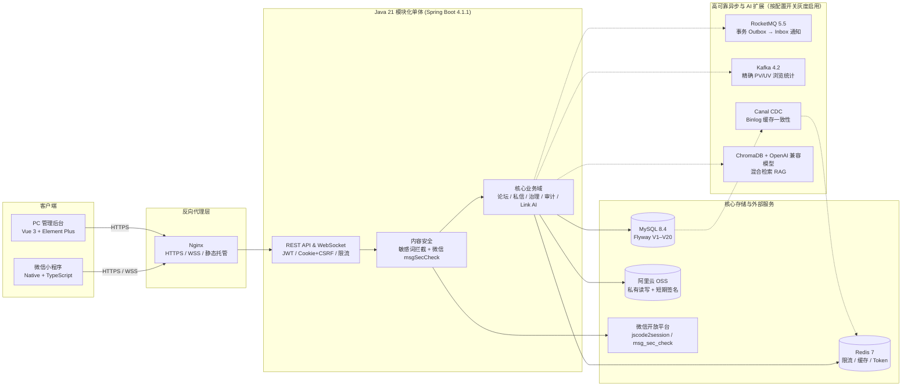

<div align="center">


# 信科 Link · XinkeLink

**面向河南信息科技学院学生的校园社交社区**

原生微信小程序 · Vue 3 管理后台 · Java 21 模块化单体服务端

[](apps/server/pom.xml)
[](apps/server/pom.xml)
[](apps/admin/package.json)
[](apps/miniprogram/package.json)
[](apps/server/src/main/resources/db/migration)
[](apps/server/src/main/resources/application-redis.yml)
[](docs/handover-to-codex-20261125.md)

</div>

---

## 项目简介

**信科 Link（XinkeLink）** 是一套围绕高校学生真实日常打造的校园社区全栈系统，采用 **Monorepo 单仓库**组织，包含 **微信小程序端**、**PC 管理后台** 与 **Java 21 服务端**三端协同。

> **定位声明**：本项目为学生校园交流社区，非学校官方网站或教务认证系统；用户自填的专业、班级与入学年份仅作展示用途，自填学号仅保存在用户本机，不上传服务端。

---

## 核心功能一览

### 📱 微信小程序端 (`apps/miniprogram`)
- **校园论坛**：支持校园生活、失物招领、学习交流、校园互助、二手闲置、吐槽、找搭子 7 大分区；支持多图发布与编辑、匿名发帖（服务端脱敏投影，匿名身份不可变）、评论与二级回复、点赞与收藏。
- **实时私信**：基于 WebSocket（WSS）实时收发消息，采用 64 位十进制消息序列水位与 HTTP 断线补取，支持未读角标、会话清空、屏蔽与举报。
- **通知与搜索**：集中查看评论、点赞、平台公告与系统通知；支持全站帖子搜索、本机搜索历史与近 7 日精确 UV 热榜（服务端灰度开关控制）。
- **合规与隐私**：内置《用户协议》与《隐私政策》查阅页，适配微信原生头像昵称填写与 `wx.onNeedPrivacyAuthorization` 隐私授权回调。

### 🖥️ PC 管理后台 (`apps/admin`)
- **数据概览**：实时聚合社区核心指标、发帖趋势图表与待处理治理事项。
- **内容与社区治理**：帖子/评论多维筛选与批量隐藏/恢复/乐观锁删除；举报队列保全证据快照与一次性处置闭环；用户多通道限权（发帖/评论/私信）与临时/永久封禁。
- **运营与审计**：公告草稿/发布/撤回与站内通知群发；独立事务追加的不可篡改操作审计日志与防公式注入 CSV 导出；系统敏感词与内容安全配置。
- **Link AI 管理**：支持学校规章资料（PDF/DOCX/TXT/MD/官网文章）提取、人工校对、版本发布与停用，以及模型凭据加密配置与 Token 用量统计。

### 🤖 Link AI 校园助手（代码已就绪 · V1.1 开放）
- 面向校园规章制度问答与自然语言查帖，采用 **中文 BM25 + 向量检索（ChromaDB）+ RRF 融合 + 外部精排（Rerank）** 混合检索架构，严格校验真实证据引用。
- V1.0 首次提审阶段已在小程序底部导航隐藏入口（保持 4 栏轻装过审），后端与管理后台代码完整保留，后续导入学校真实规章后可一键开启。

---

## 系统架构



---

## 技术栈详解

| 层级 | 技术选型 | 核心用途 |
| --- | --- | --- |
| **微信小程序** | 原生 WXML / WXSS + TypeScript 5.9 | 极简浅色 X 风格 UI、自定义四栏导航、真机 API 与本地 Fixture 双模式测试 |
| **PC 管理后台** | Vue 3.5 + TypeScript + Vite 8 + Pinia + Element Plus + Lucide | 响应式后台布局、内存 Access Token + HttpOnly Cookie 静默刷新、Playwright E2E |
| **后端核心** | Java 21 + Spring Boot 4.1.1 + Spring Security OAuth2 + MyBatis-Plus 3.5 | 无状态认证鉴权、WebSocket 实时私信、乐观锁并发控制、统一审计切面 |
| **数据库与迁移** | MySQL 8.4 + Flyway (`V1`–`V20`) | 严谨的契约式表结构演进、UTC 时区统一、迁移账号与运行时最小权限分离 |
| **缓存与限流** | Redis 7.4 + Caffeine | 认证/接口频控、微信 `stable_token` 缓存、L1+L2 帖子公共计数缓存 |
| **存储与内容安全** | 阿里云 OSS + 微信 `msg_sec_check` v2 + 后台敏感词引擎 | 私有图片短期授权访问、发帖/评论/私信/资料全链路文本实时风控 |
| **异步与 AI 扩展** | RocketMQ 5.5 / Kafka 4.2 / Canal 1.1.8 / Spring AI 2.0.2 + ChromaDB | 事务 Outbox 通知、跨日精确 UV 热榜、Binlog 缓存同步、规章知识库 RAG（均可独立开关） |
| **生产部署** | Nginx + TLS 1.2/1.3 + systemd + logrotate + MySQL 定时备份 | 4GB 单机稳态部署套装（详见 `deploy/`） |

---

## 工程与安全亮点

- **认证与防越权**：小程序端仅提交微信 `code` 由服务端换取 `openid`（绝不信任客户端身份）；管理后台采用内存 Access Token + `Secure; HttpOnly; SameSite=Strict` 刷新 Cookie + 会话绑定 CSRF Token；所有写操作均校验归属、封禁/限权状态与记录版本号。
- **内容安全闭环**：发帖、编辑、评论、私信、修改资料五大入口在加数据库行锁前同步执行**后台实时敏感词拦截**（防零宽字符绕过、保存即时失效缓存）与**微信 `msg_sec_check` v2 检测**（默认 fail-closed）。
- **数据最小权限与审计**：数据库拆分迁移账号与运行账号，运行账号对审计表仅拥有 `SELECT / INSERT` 权限；管理端写命令在事务提交后通过独立短事务落盘审计日志，脱敏不记密钥与敏感正文。
- **高可靠分布式演进设计**：已完整实现并隔离验证了 RocketMQ 事务 Outbox/Inbox 幂等通知、Kafka 精确 PV/UV 聚合与 Redis Lua CAS 原子投影、Canal Binlog 驱动的 L1/L2 缓存失效；同时支持通过环境变量一键关闭，确保小内存服务器也能稳定起步。

---

## 仓库结构

```text
XinKeLink/
├── apps/
│   ├── miniprogram/        # 原生微信小程序（TypeScript + WXML/WXSS + 370 项单测）
│   ├── admin/              # PC 管理后台（Vue 3 + Vite + Element Plus + 100 项单测 + E2E）
│   └── server/             # Java 21 服务端（Spring Boot 4.1 + Flyway V1-V20 + 389 项单测）
├── deploy/                 # 生产部署套装（Nginx HTTPS/WSS、systemd、env 模板、上线手册）
├── scripts/                # 本地初始化、启动、数据表契约与中间件运维脚本
├── docs/                   # API 契约、架构设计、验收报告与交接文档
├── BUGS.md                 # 已知缺陷与修复追踪
├── IDENTITY-RULES.md       # 访客 / 本人 / 他人三态身份与存储隔离规范
└── design-qa.md            # 小程序视觉与交互走查记录
```

---

## 快速开始

### 环境要求
- **后端**：JDK 21、Maven 3.9+、MySQL 8.4、Redis 7
- **前端**：Node.js 24+、微信开发者工具

### 1. 运行全量自动化检查

```bash
# 后端单元测试（389 项）
cd apps/server && mvn test

# PC 管理后台单测 + 类型检查 + 生产构建（100 项）
cd apps/admin && npm run check

# 微信小程序类型检查 + 单测 + 工程校验（370 项）
cd apps/miniprogram && npm run check
```

### 2. 本地启动服务
1. 参考 [apps/server/.env.example](apps/server/.env.example) 配置本地 MySQL、Redis 与 JWT 密钥（密钥仅通过环境变量注入，不入库）。
2. 启动后端服务（默认监听 `http://127.0.0.1:18081`）：
   ```powershell
   ./scripts/start-backend-dev.ps1 -Profiles "db,auth,redis"
   ```
3. 启动 PC 管理后台（默认代理 `/api` 到 `18081`，刷新 Cookie 需配置本地 HTTPS 证书访问 `https://localhost:5173`）：
   ```bash
   cd apps/admin && npm run dev
   ```
4. 使用微信开发者工具导入 `apps/miniprogram` 目录即可预览调试。

### 3. 生产环境部署
完整的 Linux 4GB 单机上线步骤（MySQL 8.4 双账号与定时备份、Redis 7、阿里云 OSS、Nginx HTTPS/WSS、systemd、微信合法域名配置与真机验收清单）请直接查看：
👉 **[生产部署手册 (`deploy/DEPLOY.md`)](deploy/DEPLOY.md)**

---

## 测试基线（2026-11-25）

| 模块 | 检查命令 | 通过数 | 说明 |
| --- | --- | ---: | --- |
| Java 服务端 | `mvn test` | **389 / 389** | 覆盖认证、论坛、私信、治理、审计、缓存、MQ/Kafka、Link AI 与内容安全 |
| PC 管理后台 | `npm run check` | **100 / 100** | Vitest 单测 + `vue-tsc` 类型检查 + Vite 生产构建全绿 |
| 微信小程序 | `npm run check` | **370 / 370** | TS 校验 + 页面/组件/身份隔离/协议合规单测 + 工程完整性校验 |
| **合计** | — | **859 / 859** | **0 失败 · 0 跳过** |

---

## 文档导航

| 文档 | 内容说明 |
| --- | --- |
| [生产部署手册](deploy/DEPLOY.md) | 服务器初始化、Nginx/WSS、systemd、MySQL/OSS 配置与提审检查表 |
| [最新上线收尾报告](docs/handover-to-codex-20261125.md) | 内容安全接入、小程序合规瘦身、部署套装与分批提交清单 |
| [正式 API 契约](docs/backend/04-api-contract.md) | 全量 HTTP 与 WebSocket 接口定义及错误码规范 |
| [项目全貌与交接记录](docs/project-handover.md) | 数据库演进、中间件验收数据、性能指标与完整工程历史 |
| [业务流程逐条走查](docs/business-flows.md) | 核心业务流程、身份判定点与本地存储 Key 清单 |
| [Link AI 第一版说明](docs/backend/23-link-ai-v1.md) | 混合检索架构、知识库导入校对发布流程与模型配置说明 |

---

<details>
<summary><strong>📜 历史里程碑与演进记录（点击展开）</strong></summary>

- **2026-11-25 V1.0 上线收尾**：后端接入微信 `msg_sec_check` v2 与实时敏感词拦截；小程序补齐《用户协议/隐私政策》与微信隐私授权、首版隐藏 Link AI 改为四栏导航、排除 `assets/mock` 打包瘦身；新增 `deploy/` 生产部署套装；三端共 859 项单测全绿。
- **2026-11-22 内测与福袋下线**：移除内测码准入与定时福袋入口及接口，Flyway `V19` 停用历史中奖通知并保留审计与历史数据（详见 [福袋交接](docs/backend/20-lucky-bag-acceptance.md)）。
- **2026-11-18 Link AI 第一版**：实现学校规章知识库混合检索问答、自然语言公开查帖与账号会话历史（Flyway `V15`–`V18`、`V20`），完成真实模型与后台导入发布验收（详见 [AI 第一版说明](docs/backend/23-link-ai-v1.md)）。
- **2026-11-17 Kafka 浏览统计热榜**：实现公开详情浏览可靠接收日志 → Kafka → 幂等精确 PV/UV 聚合 → Redis Lua CAS 原子投影 → 搜索页近 7 日 Top5（Flyway `V13`）。
- **2026-11-16 RocketMQ 互动通知**：支持赞/收藏/评论/回复通过事务 Outbox → 可靠发布 → Inbox 幂等落库，默认同步兼容（Flyway `V12`）。
- **2026-11-14 缓存与业务基线修复**：引入帖子公共计数 L1/L2 缓存与 Canal CDC 同步；完成 `B01`–`B11` 身份隔离与分类扩展修复（Flyway `V10`–`V11`）。
- **2026-11-11 业务聚焦**：移除二手交易独立模块及关联数据（Flyway `V9`，详见 [二手模块移除报告](docs/backend/19-marketplace-removal-database.md)），聚焦校园社交与社区治理。
- **2026-10-25 核心全栈联调**：完成三端真实 API 接入、WebSocket 私信、管理后台 48 个治理接口与审计日志闭环（详见 [Day 5 联调报告](docs/backend/10-day5-integration.md)）。

</details>
