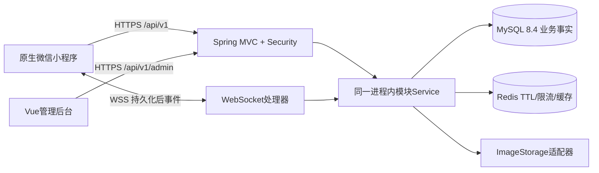

# 信科 Link 后端架构设计

> 2026-10-31补充：开发环境已接入私有OSS，新图上云、旧图本地兼容，详见[OSS接入与验证](16-oss-storage-integration.md)。下文“暂不决定存储厂商”等保留为2026-10-23设计阶段记录。

日期：2026-10-23。状态：待审阅；只形成设计，不修改当前 `apps/server`。

2026-10-24执行更新：用户已授权完成当日基础目标，采用路线B保留既有Boot 4.1.1；实测依赖、运行方法与验收见[06](06-day1-foundation.md)。下文A/B对比保留为选型记录，不代表又创建了两套工程。

2026-10-24 Day2更新：用户授权继续实现登录认证与权限，仍为Boot4.1.1/Java21，采用BOM管理的Security7.1.1/Nimbus。8个认证端点、会话轮换及验证结果见[07](07-day2-authentication.md)；真实微信与Redis7未联调通过，不表示其余业务已实现。

2026-10-25 Day3更新：论坛、评论、互动、二手商品及post/product图片依赖新增34个端点，复用现有表与事务；核心业务不强依赖Redis，既有登录限流故障策略不变。217项完整回归及真实MySQL/HTTP结果见[08](08-day3-forum-marketplace.md)。F16帖子编辑按最新授权补入契约；本轮未实现私信、治理、公告通知或管理API。

2026-10-25 Day4更新：按授权完成私信、举报限制、公告通知，新增36个HTTP端点及原生WebSocket，累计80个HTTP端点；284项完整回归及实际HTTP/WS结果见[09](09-day4-messaging-moderation.md)。业务处置历史同事务追加；全局独立安全审计和剩余管理API仍保留Day5。真实微信/Redis/生产WSS及前端接线尚未验收。

依据：[项目审查](01-current-project-audit.md)。数据定义见 [03](03-database-design.md)，接口见 [04](04-api-contract.md)，实施门禁见 [05](05-development-roadmap.md)。

## 1. 推荐架构和版本决策

采用 **Java 21、Spring MVC、模块化单体、一个 Maven 应用、MySQL 8.4、Redis 7.2、HTTP + 原生 WebSocket**。继续复用 `apps/server` 和 `cn.xinkelink` 包，不新建服务端目录，不引入多模块构建、Spring Cloud、Nacos、Gateway、MQ、Elasticsearch 或 Kubernetes。

版本兼容性与维护状态必须分开看。指定的 Boot 3.5.x 组合技术上可兼容 Java 21，但 Spring 官方元数据给出的开源支持截止日为 **2026-06-30**，早于本次计划；现有代码已经使用 4.1.1。因此建议正式后端优先沿用受维护的 **4.1.x**，但这会同时改变用户优先方案中的 Boot 与 JUnit 主版本，须审阅确认。本轮不擅自切换。

| 路线 | 适用性 | 组合及代价 |
| --- | --- | --- |
| A：按用户优先方案，Boot 3.5.16 | Java21/Spring6.2/JUnit5 学习路径清晰；开源维护窗口已结束，不建议未经维护安排直接投产 | Security6.5、Jackson2、springdoc2.8.x、MP boot3 starter；需将现有 Boot4 starter/测试包换回 Boot3 对应项 |
| B：建议正式开发沿用 Boot 4.1.x 的已核实最新补丁 | 与仓库骨架同代、维护窗口更长；API/数据库不变 | MP boot4 starter、springdoc3.1.x、Boot BOM 对应 Security/Jackson/JUnit；当前官方4.1系 BOM 管理 JUnit Jupiter6.0.3，不能继续宣称 JUnit5 |

**本目录模型和接口不依赖 A/B。** 后续实施先决定路线，冻结 dependency tree，再写业务。不能混用 Boot3 starter、Boot4测试包、springdoc3 与 Security6 等跨代组合。也不建议为保留 JUnit5 强行覆盖 Boot4 的测试 BOM。

## 2. 已核查的兼容矩阵

下表是官方文档/源码层面的核查，不是本轮 Maven 集成、数据库或迁移实测。实现时固定精确补丁，不使用 `LATEST`、动态版本或 SNAPSHOT。

| 项目 | 路线 A 基线/规则 | 结论 |
| --- | --- | --- |
| JDK | 21 LTS，构建和运行均用21；Maven≥3.6.3，建议沿用已安装3.9.x | Boot3.5.16支持Java17–25；本机Maven目前用25，后续要明确JDK21工具链 |
| Boot/MVC | 3.5.16、`spring-boot-starter-web` | 不能照搬当前4.1.1的`starter-webmvc`；保留现有健康路径 |
| Security/JWT | Boot BOM 的 Security6.5.11；`starter-security` + OAuth2 Resource Server/JOSE | 使用同一套 Nimbus JWT 编解码，不额外再引入一套 JJWT；不是搭建 OAuth 授权服务器 |
| MyBatis-Plus | 官方当前3.5.17的`mybatis-plus-spring-boot3-starter`；分页另配同版`mybatis-plus-jsqlparser` | 不叠加原生MyBatis starter；基础CRUD用MP，跨表/锁定/聚合用明确SQL |
| MySQL | 8.4 LTS、InnoDB、utf8mb4 | Connector/J版本不必等于服务端8.4；Boot3.5.16 BOM为9.7.0，官方该驱动支持MySQL8.0+ |
| Redis | 7.2.x维护补丁；Spring Data Redis/Lettuce由Boot BOM管理 | 只用TTL/限流/缓存等基础命令；7.4许可证与7.2不同，不在本轮擅自改线 |
| Validation | `spring-boot-starter-validation`，`jakarta.validation` | 不使用旧javax.validation；限长/枚举和跨字段状态分别在DTO/Service验证 |
| OpenAPI | `springdoc-openapi-starter-webmvc-ui` 2.8.x精确补丁 | 官方矩阵将Boot3.5与2.8.x配对；Boot4需3.x；不使用Springfox |
| Flyway | `flyway-core` + **`flyway-mysql`**，同版本；Boot3.5.16 BOM为11.7.2 | 不能只加core；该tag的MySQL源码仍以8.1为升级建议边界，8.4可能出现未认证警告，必须在实际8.4执行迁移/校验/重启实测后冻结；失败时评估同版更新的core/mysql或路线B BOM，不盲目压掉提示 |
| 测试 | `spring-boot-starter-test`、JUnit Jupiter5、Mockito（BOM）及security-test | 当前`starter-webmvc-test`与`org.springframework.boot.webmvc.test.autoconfigure.AutoConfigureMockMvc`是Boot4布局；路线A改为Boot3的`org.springframework.boot.test.autoconfigure.web.servlet.AutoConfigureMockMvc` |

官方依据（核查日期2026-10-23）：[Boot3.5系统要求](https://docs.spring.io/spring-boot/3.5/system-requirements.html)、[Boot3.5依赖矩阵](https://docs.spring.io/spring-boot/3.5/appendix/dependency-versions/coordinates.html)、[Spring支持元数据](https://api.spring.io/projects/spring-boot/generations)、[MP安装](https://baomidou.com/getting-started/install/)、[springdoc兼容矩阵](https://springdoc.org/v2/#what-is-the-compatibility-matrix-of-springdoc-openapi-with-spring-boot)、[Boot4.1依赖矩阵](https://docs.spring.io/spring-boot/4.1/appendix/dependency-versions/coordinates.html)、[Connector/J9.7发行说明](https://dev.mysql.com/doc/relnotes/connector-j/en/news-9-7-0.html)、[Flyway MySQL模块](https://documentation.red-gate.com/flyway/reference/database-driver-reference/mysql)、[Flyway11.7.2 MySQL源码](https://github.com/flyway/flyway/blob/flyway-11.7.2/flyway-database/flyway-mysql/src/main/java/org/flywaydb/database/mysql/MySQLDatabase.java)、[Redis版本维护](https://redis.io/docs/latest/operate/oss_and_stack/install/version-mgmt/)。

数据库/Redis补丁、springdoc的精确小版本及路线B完整BOM在10/24冻结前再核对；当前文档不声称已经解析下载或跑过这些组合。参考页随厂商发布变化，冻结结果应记录在后续实施证据中。

## 3. 模块、目录和依赖方向

```text
apps/server/                     沿用现有pom、src和包名
  src/main/java/cn/xinkelink/
    XinkeLinkApplication.java
    common/                      响应、错误、时间、分页、请求关联ID
    auth/                        微信身份适配、管理员密码、JWT/会话/权限
    user/                        本人/公开资料、偏好、屏蔽、有效限制
    forum/                       帖子、两级评论、互动、搜索服务
    market/                      商品和卖家操作
    messaging/                   一对一会话、消息、已读/清空水位、WSS事件
    governance/                  举报、人工处置、用户限制和处理历史
    operation/                   公告、站内通知任务/接收记录、统计
    audit/                       服务端只读审计、脱敏、CSV
    setting/                     配置存取及版本化恢复默认
    storage/                     保留ImageStorage边界、媒体权限与引用
    health/                      保留健康Controller
  src/main/resources/
    application.yml              之后按profile组织；密钥只读环境变量
    mapper/                      必要的复杂SQL
    db/migration/                后续批准实施后才新增Flyway脚本
  src/test/java/cn/xinkelink/      同模块测试，保留健康回归
```

各业务模块内部采用 `controller/dto/service/mapper/entity`；不为了目录一致给极小模块制造空层。Controller只鉴别输入/身份及转换DTO；Service执行规则和事务；Mapper负责参数化SQL；Entity不直接作为公开响应。模块之间调用Service提供的窄接口，不从Controller跨域改表，也不互相嵌套自动记录同一个审计动作。



不引入共享TypeScript类型构建。OpenAPI为后续代码契约来源，两端在既有仓储/Store边界做字段适配；本轮不生成客户端或重构前端。

## 4. 微信登录、管理员认证与权限

### 4.1 微信身份流程

1. 小程序主动调用真正的 `wx.login` 取得临时code，经HTTPS提交 `POST /api/v1/auth/wechat`。
2. 服务端使用**自身配置**的AppID/AppSecret和code请求微信固定的 `jscode2session` 地址；AppID不由请求体任意选择，不接受客户端传入的openid或“演示已登录”布尔值。
3. 校验微信业务错误和openid；按 `(wechat_app_id,wechat_open_id)` 唯一约束查找/创建用户，处理并发首次登录。unionid仅可选关联信息，首版无需跨应用合并账号。
4. 创建本平台会话，签发自己的短期access JWT和可轮换的随机refresh token。**不把openid、code或session_key当登录票据；不向前端返回AppSecret/session_key。** 当前不需要微信加密资料解密时，不持久化session_key。
5. 用户头像/昵称走本人资料表单，不假设换code自动得到这些资料；不获取手机号，不推断在校/学校认证。
6. 微信错误统一映射安全错误；换码超时不反复重用同一code，客户端重新取code。限流、超时、固定目标地址和响应校验都由服务端负责。

官方协议参考：[微信登录流程](https://developers.weixin.qq.com/miniprogram/dev/framework/open-ability/login.html)、[code2Session](https://developers.weixin.qq.com/miniprogram/dev/OpenApiDoc/user-login/code2Session.html)。本轮浏览器无法读取这些官方页面，已明确记录访问限制；没有请求微信身份接口，也没有使用真实code。以上为拟定流程，10/25必须用可访问的官方文档和真实开发账号核验错误码/平台要求，不能据文档设计宣布微信接入通过。

### 4.2 会话和管理员

- JWT仅放 `sub/sid/actorType/aud/iss/iat/exp/jti`，不放手机号、学号、昵称或整份权限资料。小程序与管理员audience分开，不能互换token。
- access TTL建议15分钟；小程序refresh最长30天、管理员refresh最长8小时，均是待确认的首版配置建议。refresh为高熵随机值，数据库只存SHA-256摘要，成功刷新后原值原子作废；退出吊销当前sid。
- 小程序refresh通过HTTPS响应返回并存设备Storage；管理员access仅内存，refresh放HttpOnly/Secure/SameSite=Strict cookie。管理员refresh/logout要求受信Origin及与会话绑定的CSRF token，不将密码或token放localStorage/URL/日志。
- 管理员只有固定 `ADMIN` 角色，服务端逐接口授权；没有管理员注册、角色配置页、第三方登录。初始化账号以后续安全环境配置/离线运维步骤创建BCrypt哈希，仓库和页面不放真实初始密码。
- 登录、刷新、全部用户写入口重新校验账号封禁和通道限制；永久封禁不能被举报限制、到期任务或解除接口意外覆盖。封禁吊销既有会话；公开浏览的访客权限不代表账号可继续写。
- 普通用户只能改本人资料/内容；管理员查看匿名真实作者、举报证据和处理历史均在admin接口。用户不能读取其他人的私信，管理员也不提供任意会话浏览接口，只能在举报案件内查看有权限的指定证据。

## 5. 持久化、并发与日志边界

- MySQL是用户、内容、互动、商品、消息、接收通知和设置的事实来源。Redis不保存唯一的业务事实，不将“缓存成功”当发送成功。
- `@Transactional`放应用Service；默认使用READ_COMMITTED，关键修改依赖明确行锁/版本条件/唯一约束，不依赖偶然的间隙锁。举报处置将报告状态、目标变化、业务处理历史和必要的站内提示同事务提交。失败全部回滚；并发第二次处理返回409。
- 商品编辑/状态、用户限制、公告/通知/设置使用 `version` 条件更新；`sold` 永远不回到 `available`。点赞收藏靠唯一索引；创建消息/内容靠客户端请求ID唯一约束。
- 计数首版用有效记录聚合，按页批量查询，避免Mock基础数和N+1。隐藏父内容后的子项、收藏、通知必须使用同一可见性谓词。
- 业务处置历史属于业务事务，保存必要原因和状态快照；**安全审计日志另行隔离**，不把处置原因、正文、密钥写入审计。
- 审计统一由应用命令边界记录；成功在业务提交后记录，规则拒绝记 `business_rejected`，异常记 `execution_error` 并保持原异常传播。记录器必须覆盖事务代理提交结果，不能在@Transactional方法体返回前先记success；提交失败应归执行异常。举报内部联动不再记重复内容事件；批量动作一条附真实变更数。`operationId`唯一，客户端重试不能复制同一事件。
- 审计采用独立事务/受控writer；writer异常被隔离，不改变已提交状态、返回值或原异常。失败写脱敏运维告警。**该可用性策略存在审计缺口风险**，不能承诺绝不丢记录；如果未来要求强保证，需另行决定同事务持久投递机制，不应悄悄让审计故障回滚已成功业务。
- 审计API无更新/删除，数据库运行账号对审计表只授予INSERT/SELECT，迁移账号另管；普通用户无任何审计访问权限。服务端持久记录才是后续审计来源，现有前端内存日志不是正式凭证。

## 6. 私信：HTTP持久化与WSS

首版单实例、原生WebSocket JSON协议，不用STOMP/SockJS/MQ。同一用户对只有一个会话，商品仅是消息关联；旧market-chat与contact-chat以后都接同一服务。

发送以HTTP为唯一首版业务命令：验证成员、限制/屏蔽和可选商品；锁会话分配递增序号，写MySQL并提交，返回确认，然后WSS推送 `message.created/conversation.updated/read.updated/unread.updated`。不额外实现一条语义不同的WS发送通道。

`senderId + clientMessageId`唯一；HTTP超时后同ID重试返回原消息，不新写一条。WSS可能丢失/重复/乱序，客户端依 `messageId/sequence`去重排序；重连通过HTTP的afterSequence补取。`sent`只表示服务端已持久化，不表示对方已送达/已读。未实现的delivered回执不伪造。

WSS握手使用小程序 `wx.connectSocket` 的Authorization header，固定连接 `/api/v1/ws`，不用URL传JWT；实施时核对平台header能力及WSS域名配置，若不满足再设计一次性短期ticket，不把长期token退化放入query。连接在token失效/会话吊销时关闭；心跳、限流、大小上限和断线重连是10/27验收项。

已读/清空以序号水位而非客户端时钟为准；清空仅影响当前成员，不删对方历史。会话历史商品售出不永久禁用普通文字；只有明确带商品的新咨询需该商品在售。屏蔽先保持现有“本人禁止向对方新发”语义，双向拒收需要审阅决定。

## 7. 图片和访问控制

保留现有 `ImageStorage.store/delete` 三个类型作为厂商边界；业务媒体服务补充 owner、用途、尺寸、引用和访问权限。开发期可用非静态目录的本地磁盘适配器，生产存储厂商暂不决定。

- 上传与发布分开：先得到imageId，再在业务事务中核验归属/用途/数量并绑定。客户端不能提交任意URL、wxfile、本机路径、存储key或他人imageId。
- 实际流量强制≤10MiB，检查文件签名、可解码类型/尺寸，原文件名/MIME/声明size不可信；生成存储key，防路径穿越、解压/超大图风险并清理公开图片的定位元数据。具体格式和尺寸边界见04。
- 提供短期、按imageId和授权主体/用途限定的访问grant及内容代理。媒体内容请求仍检查当前父内容可见性和会话状态，不把举报证据放公共静态目录；URL查询中的grant不进日志。
- 公开匿名图片不能携带作者资料/原文件名；原图中用户主动拍到的身份信息不能靠匿名标记保证消除，应在发布提示/治理中处理。
- 临时未绑定资源与引用中资源分开清理；更换头像/编辑/删除内容不能误删其他引用或举报保全的文件。存储失败不提交内容，不把对象存储网络调用放在长数据库锁内。

## 8. 设置、统计与运维最小边界

审核四项配置在数据库持久化、可保存/重置且有日志，响应明确 `effectMode=configuration_only`；**不自动拦截帖子、不启动夜间队列、不调用AI/OCR**。社区分段、平台品牌、账号身份和环境参数保持只读。新规则要生效必须另有政策和实施验收，不能仅凭开关存在就宣传已执行。

Dashboard用真实表计数及时间范围；日活可通过用户日活动表去重，收集成功鉴权的业务访问而非心跳，日期口径Asia/Shanghai。没有采集的停留时长、服务器状态、安全结论返回null及unavailable原因，禁止补随机值。推荐首版不建复杂分析平台。

配置通过profile/环境变量注入；本机绑定/端口沿用现有配置，不默认公开网络。生产HTTPS/WSS、微信合法域名、AppID/密钥、MySQL/Redis账号和存储权限是后续准备项。本轮不安装、不启动这些服务。

Redis用途限于登录/上传限流、短期会话/权限缓存和统计读缓存；数据库仍可校验会话和限制。Redis故障不能丢消息/放过封禁；敏感入口无法执行必要限流时返回可重试503，普通读取可回源MySQL。审计日志不得包含Authorization、Cookie、code、token、session_key、密码、正文或完整异常请求。

## 9. 本轮未解决、需审阅的决定

1. Boot路线A（指定3.5/JUnit5）还是B（建议4.1维护线/JUnit6）；决定前不修改pom。
2. 是否保持学号仅本机承诺（本设计默认保持）；不默认收集学号或验证在校身份。
3. 五天是否接受仅交核心纵向闭环、其余延后；不能把前端Mock验收折算成后端完成。
4. 开发图片存储是否接受本地适配器；生产厂商和真实微信/HTTPS环境何时具备。
5. 双向屏蔽、临时封禁到期保留人工限制、治理下架对公众只返回占位等差异，详见03/05，作为明确的后端安全规则审阅，不在前端悄悄改动。
