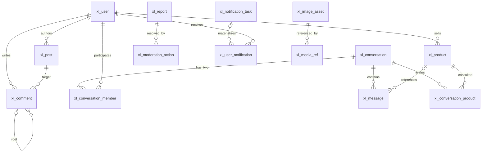

# 信科 Link MySQL 数据库设计

日期：2026-10-23。状态：逻辑/物理设计，待审阅；**没有创建SQL文件、连接数据库或执行迁移**。

2026-10-24执行更新：上句描述设计交付时状态；现已按本设计新增5个Flyway迁移，并在隔离MySQL8.4开发库实测，结果见[06](06-day1-foundation.md)。未创建真实业务账号或迁移前端Mock数据。

与 [02](02-backend-architecture.md) 和 [04](04-api-contract.md) 共用实体、状态和权限。规划 **24 张业务表（23 张基础表 + 1 张可简化的用户活动日表）**；Flyway自身的`flyway_schema_history`另计1张。没有角色权限关系网、订单、支付、话题、认证、搜索历史或云草稿表。

## 1. 全局约定

- MySQL8.4/InnoDB，数据库字符集`utf8mb4`，正文采用`utf8mb4_0900_ai_ci`；openid、token摘要、客户端请求ID及机器枚举按二进制/区分大小写比较。所有SQL参数化；排序仅允许服务端白名单。
- 业务主键`BIGINT UNSIGNED AUTO_INCREMENT`，对外序列化为字符串；前端不解析ID含义。`local-student`、掩码学号和“匿名”不能导入为FK。真实用户资料默认不存学号，见01。
- 所有日期时间为`DATETIME(3)`，应用/连接统一UTC；非空创建时间默认`CURRENT_TIMESTAMP(3)`。业务日统计按Asia/Shanghai计算，不能以数据库机器默认时区推断“今日”。API统一ISO8601 UTC毫秒。
- 下文公共列模板：**M**=`id`主键、`created_at`/`updated_at`非空UTC当前时间、`version INT UNSIGNED NOT NULL DEFAULT 0`；更新显式写`updated_at`和递增version。**D**=M加`deleted_at DATETIME(3) NULL DEFAULT NULL`。**J**=`id`主键和`created_at`，追加记录不提供修改/删除；不可变表不人为增加无意义updated_at。
- 没写NULL的自定义列均NOT NULL；“无默认/必填”表示插入必须提供，不让MySQL补空值。VARCHAR长度是存储上界，服务端另按DTO限制。正文换行允许，脚本/HTML不作为富文本执行。
- 表节中省略重复类型的`FK user/admin/conversation/...`列统一为`BIGINT UNSIGNED`；引用对象的`*_id`同类型，NULL只在明确标出时允许。关系表复合主键不额外增加自增id；没有显式默认值的列均须写入，不以空串代替缺失关联。
- 明确单实体关联可建FK，`ON DELETE RESTRICT`，不物理级联用户/内容；多态目标与跨主体会话的逻辑关联由同一Service事务验证。迁移时先建表后补循环FK。绝不依赖逻辑关联跳过权限校验。
- 软删与隐藏不同：软删是不可由普通恢复接口恢复的删除；隐藏是可审核恢复的可见性变化。关系表点赞/收藏/屏蔽使用物理删行，防止软删唯一键阻碍再次操作。

## 2. 表目录与主要关联

| # | 表 | 用途 | 主体/主要关系 |
| --- | --- | --- | --- |
| 1 | xl_user | 微信用户、资料、人工限制/封禁 | 作者、卖家、消息成员、举报参与人 |
| 2 | xl_user_preference | 通知偏好 | user一对一 |
| 3 | xl_user_block | 本人屏蔽关系 | owner→peer |
| 4 | xl_admin | 管理员认证与角色 | 处置、公告、通知、审计 |
| 5 | xl_auth_session | 可吊销/轮换的用户或管理员会话 | subject_type+subject_id逻辑关联 |
| 6 | xl_post | 帖子正文、匿名和治理状态 | author→user |
| 7 | xl_comment | 两级评论/回复 | author、target、root、replyTo |
| 8 | xl_like | 帖子/评论/商品点赞 | user+多态目标唯一 |
| 9 | xl_favorite | 帖子/商品收藏 | user+多态目标唯一 |
| 10 | xl_product | 商品及状态 | seller→user |
| 11 | xl_conversation | 一对一用户对 | low_user/high_user唯一 |
| 12 | xl_conversation_member | 每人已读/清空/会话偏好 | conversation+user复合主键 |
| 13 | xl_message | 持久化文字和商品关联 | conversation、sender、product可选 |
| 14 | xl_report | 举报、目标快照、审核结果 | reporter、目标/目标用户、审核人 |
| 15 | xl_moderation_action | 业务处置历史与原因 | report/target/target_user/admin |
| 16 | xl_announcement | 社区公告草稿/发布/撤回 | creator/updater→admin |
| 17 | xl_notification_task | 管理员站内通知任务 | creator→admin；发送后只读 |
| 18 | xl_user_notification | 实际接收通知及已读状态 | recipient、互动目标或通知任务 |
| 19 | xl_audit_log | 管理动作安全审计 | admin及内部受控目标引用 |
| 20 | xl_system_setting | 版本化配置值 | 更新者→admin |
| 21 | xl_image_asset | 文件元信息、归属与存储标识 | owner→user |
| 22 | xl_media_ref | 文件与头像/帖子/商品/举报绑定 | asset FK + 多态owner |
| 23 | xl_user_activity_day | 可简化的真实日活去重 | user+业务日期复合主键 |
| 24 | xl_conversation_product | 打开咨询即保存商品关联，独立于是否发送消息 | conversation+product复合主键 |

图中post/comment是当前公开流程；comment的多态product关联仅为已有后台数据模型提供明确容器，首版不新增商品评论发布UI/API。

## 3. 身份与用户表

### 3.1 xl_user（D）

| 字段 | 类型/默认 | 规则 |
| --- | --- | --- |
| wechat_app_id | VARCHAR(32)，必填 | 服务端配置值 |
| wechat_open_id | VARCHAR(128)二进制比较，必填 | 仅服务端认证使用，不公开/不进审计 |
| nickname | VARCHAR(20)，默认“新同学” | trim后1–20 |
| avatar_image_id | BIGINT UNSIGNED NULL | FK image_asset，V5后补以解决循环；默认平台头像 |
| bio | VARCHAR(40)，默认空 | 自填 |
| major / class_name | VARCHAR(60)/VARCHAR(40)，默认空 | 自填、未经平台核实 |
| enrollment_year | CHAR(4) NULL | 空或匹配`^(19\|20)\d{2}$`；沿用现有表单，不作为认证证明 |
| ban_state | VARCHAR(16)，默认none | none/temporary/permanent；与人工限制分离 |
| ban_until | DATETIME(3) NULL | temporary必有、其他为空 |
| restrict_publish / restrict_comment / restrict_message | BOOLEAN，默认false | 人工通道限制；不会因临时封禁到期清除 |
| last_active_at | DATETIME(3) NULL | 服务端有效业务访问更新时间 |

唯一索引`uk_user_wechat(wechat_app_id,wechat_open_id)`；普通索引`idx_user_created(deleted_at,created_at,id)`、`idx_user_ban(ban_state,ban_until)`、`idx_user_active(last_active_at,id)`。不建立student_no/studentId字段、手机号字段或学校认证状态。学校名称作为服务范围配置展示，不让用户填写值产生官方身份。

API账号状态投影：permanent→`permanently_banned`；未过期temporary→`banned`；否则任一人工限制→`restricted`；否则`active`。返回`restrictions`为有效限制，必要时ADMIN详情另返回manualRestrictions用于解释来源。到期只清临时层并保留人工标志。

### 3.2 xl_user_preference（自定义PK）

`user_id BIGINT UNSIGNED PK/FK`；`messages/interactions/announcements BOOLEAN DEFAULT true`；`sound BOOLEAN DEFAULT false`；`created_at/updated_at`同M；`version INT UNSIGNED DEFAULT 0`。缺行时读取默认值，首次保存upsert。偏好影响站内角标/提醒展示，不代表微信系统推送授权。

### 3.3 xl_user_block（关系表）

`owner_id/blocked_user_id BIGINT UNSIGNED`均FK user，复合PK(owner_id,blocked_user_id)；`created_at`默认当前UTC。禁止owner=peer，DELETE表示解除；反向索引`idx_block_peer(blocked_user_id,owner_id)`。默认语义是屏蔽者本人不能向对方新发，不隐藏既有历史；是否升级双向拒收见05决策项。

### 3.4 xl_admin（M）

`login_name VARCHAR(64)`归一后唯一；`password_hash VARCHAR(100)`必填BCrypt结果；`display_name VARCHAR(20)`必填；`role VARCHAR(16) DEFAULT 'ADMIN'`；`status VARCHAR(16) DEFAULT 'active'`（active/disabled）；`password_changed_at DATETIME(3)`必填；`last_login_at DATETIME(3) NULL`。唯一索引`uk_admin_login(login_name)`。不向客户端返回hash，不提供注册/角色编辑表或API。

### 3.5 xl_auth_session（M）

`subject_type VARCHAR(8)`=user/admin、`subject_id BIGINT UNSIGNED`必填逻辑关联；`refresh_hash BINARY(32)`必填；`refresh_generation INT UNSIGNED DEFAULT 0`；`csrf_hash BINARY(32) NULL`（admin使用）；`expires_at DATETIME(3)`必填；`revoked_at/last_used_at DATETIME(3) NULL`。`uk_session_refresh(refresh_hash)`，`idx_session_subject(subject_type,subject_id,revoked_at)`，`idx_session_expiry(expires_at)`。JWT含sid；只存refresh摘要，不存明文token/password/code/session_key。刷新用旧摘要+版本条件更新，旧票据不可复用。

## 4. 论坛、评论与互动

### 4.1 xl_post（D）

`author_id BIGINT UNSIGNED FK user`；`category VARCHAR(16)`必填（campus/lost_found/study/help）；`content VARCHAR(2000)`必填；`is_anonymous BOOLEAN DEFAULT false`；`anonymous_label VARCHAR(24) NULL`（匿名帖必填、按帖子生成，不以学号/作者ID派生）；`status VARCHAR(16) DEFAULT visible`（visible/hidden）；`review_state VARCHAR(16) DEFAULT normal`（normal/pending）；`client_request_id VARCHAR(64) ASCII`必填；`request_hash BINARY(32)`必填（规范化初次请求的SHA-256，不随内容状态变化）。

`uk_post_request(author_id,client_request_id)`；`idx_post_feed(deleted_at,status,review_state,created_at,id)`；`idx_post_category(category,deleted_at,status,created_at,id)`；`idx_post_author(author_id,deleted_at,created_at,id)`。没有独立title列，小程序是动态正文；ADMIN标题由正文前若干字安全派生。图片通过media_ref，不在表中存wxfile或任意URL。

真实作者始终存在数据库；公开DTO去authorId/真实头像/专业等，匿名作者自己的评论也按所属post匿名投影。ADMIN授权详情和本人管理可以识别归属，但公共搜索不能按匿名真实昵称匹配。

### 4.2 xl_comment（D）

`target_type VARCHAR(12)`=post/product，`target_id BIGINT UNSIGNED`逻辑关联；`author_id BIGINT UNSIGNED FK user`；`root_id BIGINT UNSIGNED NULL FK comment`；`reply_to_id BIGINT UNSIGNED NULL FK comment`；`content VARCHAR(1000)`必填；`status VARCHAR(16) DEFAULT visible`；`client_request_id VARCHAR(64) ASCII`必填；`request_hash BINARY(32)`必填。

`uk_comment_request(author_id,client_request_id)`；`idx_comment_target(target_type,target_id,deleted_at,status,root_id,created_at,id)`；`idx_comment_root(root_id,deleted_at,status,created_at,id)`；`idx_comment_author(author_id,deleted_at,created_at,id)`。target_type=product仅用于已有后台关联模型/以后历史；首版用户创建只允许post。

一级：root_id/reply_to_id均NULL。二级：root_id指该目标的一级，reply_to_id指同一根下目标或一级；回复二级仍落到该根，禁止三级、跨帖/商品回复。创建时验证目标及根仍有效。

删除一级软删其全部二级；删除二级不删其他二级，指向已删项的replyTo公开名为空。隐藏一级不篡改回复自己的status，但公共有效可见性要求目标、根和本条均可见，计数也如此；恢复根不得恢复被单独隐藏/删除的回复。

### 4.3 xl_like / xl_favorite（两个关系表）

两表共同列：`user_id BIGINT UNSIGNED FK user`、`target_type VARCHAR(12)`、`target_id BIGINT UNSIGNED`、`created_at DATETIME(3) DEFAULT CURRENT_TIMESTAMP(3)`。两表的复合主键均为`(user_id,target_type,target_id)`，天然防重复；反向索引`idx_{like|favorite}_target(target_type,target_id,user_id)`；个人时间索引`idx_{like|favorite}_user_time(user_id,created_at,target_id)`。

like允许post/comment/product（V6扩展）；favorite允许post/product，仅历史兼容。PUT存在则幂等成功，DELETE不存在亦幂等成功。目标ID由业务验证，不建跨表多态FK。取消关系可作用于已失效目标，以便清理收藏；新加关系要求目标有效/可访问。计数使用真实有效关系聚合，没有Mock基础数。关系无updated_at，因为不原地改为另一目标。

## 5. 二手商品

### 5.1 xl_product（D）

| 字段 | 类型/默认 | 规则 |
| --- | --- | --- |
| seller_id | BIGINT UNSIGNED FK user，必填 | 不接受客户端伪造卖家 |
| title / description | VARCHAR(60)/VARCHAR(1000)，必填 | trim非空 |
| category | VARCHAR(16)，必填 | digital/books/living/fashion/other |
| price_fen | INT UNSIGNED，必填 | CHECK 1–9999999，不用double |
| condition_score | TINYINT UNSIGNED，必填 | 100/99/95/90/80 |
| negotiable | BOOLEAN，默认true | 无购物车/支付字段 |
| sale_status | VARCHAR(16)，默认available | available/off_shelf/sold |
| review_state | VARCHAR(16)，默认normal | normal/pending；不增未设计审批按钮 |
| moderation_hidden | BOOLEAN，默认false | 管理员/举报治理保持，卖家不可自行清除 |
| client_request_id | VARCHAR(64) ASCII，必填 | 创建重试唯一 |
| request_hash | BINARY(32)，必填 | 初次创建请求摘要，编辑后保留，避免用编辑后的内容误判创建重试 |

索引`uk_product_request(seller_id,client_request_id)`；`idx_product_public(deleted_at,moderation_hidden,review_state,sale_status,created_at,id)`；`idx_product_category(category,deleted_at,created_at,id)`；`idx_product_price(deleted_at,price_fen,id)`；`idx_product_seller(seller_id,deleted_at,sale_status,created_at,id)`。成色/议价在候选集过滤，首版包含搜索不承诺索引扫描优化。

### 5.2 状态转换与公开读取

| 命令 | 前置 | 结果 |
| --- | --- | --- |
| 卖家下架 | available且非已删除 | off_shelf；不清治理标记 |
| 卖家上架 | off_shelf且review=normal且moderation_hidden=false | available |
| 卖家售出 | available | sold，终态；保留历史 |
| 卖家编辑 | 本人、未删除、非sold、版本匹配 | 只改内容；ID/创建时间/卖家/状态不变；治理标记不变 |
| 管理下架/举报下架 | 目标未删除 | 非sold→off_shelf，moderation_hidden=true；sold仍sold但内容治理隐藏，**明确返回此效果** |
| 管理恢复上架 | off_shelf且review=normal | available并清moderation_hidden；任何sold都拒绝重上架 |
| 管理删除 | 未删除且版本匹配 | 软删除，不级联删除举报/消息历史 |

这比Mock的一个status字段多一个治理维度，目的是防卖家绕过处置，以及避免“已售举报处理成功但没有任何效果”。不新增售出恢复能力。

普通列表：未删、review=normal、未治理隐藏且sale_status非off_shelf；默认推荐无关键词时另排除sold，分类/关键词搜索可以展示sold。所有排序最终用id稳定决胜。商品自己下架/售出仍可通过收藏或既有ID查看历史详情；治理隐藏/删除则给普通用户脱敏不可用占位，不能继续暴露违规正文/图。本人/ADMIN可按权限查看，普通用户不能借收藏越过治理。

## 6. 会话、消息、已读与清空

### 6.1 xl_conversation（M）

`low_user_id/high_user_id BIGINT UNSIGNED FK user`，按数值排序且CHECK low<high；`next_sequence BIGINT UNSIGNED DEFAULT 1`；`last_message_id BIGINT UNSIGNED NULL`逻辑关联message；`last_message_at DATETIME(3) NULL`。`uk_conversation_pair(low_user_id,high_user_id)`，`idx_conversation_activity(last_message_at,id)`。两用户创建会话并插入两条member同事务完成；禁止自己与自己会话。

### 6.2 xl_conversation_member（复合PK）

`conversation_id FK conversation`、`user_id FK user`复合主键；`read_through_seq/cleared_through_seq BIGINT UNSIGNED DEFAULT 0`；`muted/pinned BOOLEAN DEFAULT false`；`created_at/updated_at`同M、`version INT UNSIGNED DEFAULT 0`。`idx_member_user(user_id,pinned,conversation_id)`；Service保证成员恰为conversation两人。

读水位只增不减且不得超过服务端已提交最高序号；清空要求`existingClear ≤ clearThroughSequence ≤ highestCommittedSequence`，未来水位拒绝，旧水位不倒退；同时更新`read=max(read,clear)`，不物理删消息。未读=其他人正常可见消息中seq>max(read,clear)的数量；置顶影响列表排序，免打扰值先持久化，不冒充微信推送开关。

### 6.3 xl_message（M，正文不可编辑）

`conversation_id FK conversation`、`sender_id FK user`；`sequence_no BIGINT UNSIGNED`必填；`client_message_id VARCHAR(64) ASCII`必填；`request_hash BINARY(32)`必填（含会话ID/文字/可选商品ID）；`kind VARCHAR(12) DEFAULT text`；`text VARCHAR(1000)`必填；`product_id BIGINT UNSIGNED NULL`逻辑关联；`product_title_snapshot VARCHAR(60) NULL`、`product_price_fen_snapshot INT UNSIGNED NULL`；`moderation_state VARCHAR(16) DEFAULT normal`（normal/hidden）。

`uk_message_sequence(conversation_id,sequence_no)`；`uk_message_client(sender_id,client_message_id)`；历史查询由前述sequence唯一索引覆盖，不再重复建同列`idx_message_history`；`idx_message_product(product_id,sender_id)`。不存在虚构delivered/read字段；读状态来自member水位，HTTP成功意味着已持久化。

锁conversation行后分配seq并写消息、更新last指针同事务，提交后才推WSS。重发相同client_message_id返回原消息；若payload不同则409。历史关键词只查当前成员可见范围；隐藏消息保留ID/序号占位，不能影响序号连续补取。商品已删或治理隐藏时卡片脱敏，历史快照不用于泄露受限正文。

### 6.4 xl_conversation_product（关系表）

`conversation_id FK conversation`、`product_id FK product`复合主键；`attached_by FK user`必填且必须为会话成员，保留首次关联者；`created_at/updated_at`为UTC当前时间。索引`idx_conversation_product_recent(conversation_id,updated_at,product_id)`、`idx_product_inquiry(product_id,conversation_id)`。商品必须属于会话其中一方；从“我想要”打开时即在同一事务upsert此关系，即使没有发送消息也保留，重复打开只更新最近关联时间，不生成假消息或未读。带商品发送同样核验并upsert，不覆盖首次关联者。列表按最近关联时间读取，商品变化通过原ID投影；下架/售出保留历史，治理隐藏/删除脱敏。咨询人数按该商品关联会话中的非卖家成员去重，不用消息条数冒充人数。成员清空只隐藏消息，不删此历史关联；没有为每个商品另建会话。

## 7. 举报和业务处理历史

### 7.1 xl_report（M，不允许普通用户编辑）

`reporter_id FK user`；`target_type VARCHAR(12)`=post/comment/product/user/message；`target_id BIGINT UNSIGNED`逻辑关联；`target_user_id BIGINT UNSIGNED FK user`服务端推导；`reason_code VARCHAR(32)`必填；`description VARCHAR(200)`必填；`priority VARCHAR(8) DEFAULT medium`；`status VARCHAR(12) DEFAULT pending`；`target_snapshot JSON`必填受控原文/身份快照；`resolution VARCHAR(32) NULL`、`resolution_reason VARCHAR(200) NULL`、`resolved_by BIGINT UNSIGNED NULL FK admin`、`resolved_at DATETIME(3) NULL`；`client_request_id VARCHAR(64) ASCII`必填；`request_hash BINARY(32)`必填。

生成列`pending_guard TINYINT`为status=pending时1、否则NULL，建立`uk_report_pending(reporter_id,target_type,target_id,pending_guard)`；另外`uk_report_request(reporter_id,client_request_id)`。普通索引`idx_report_queue(status,priority,created_at,id)`、`idx_report_target(target_type,target_id)`、`idx_report_user(target_user_id,created_at,id)`。状态/优先级非字母自然排序，查询用明确CASE顺序。

原设计按现有小程序只开放post/product/user；2026-10-25 Day4按用户最新要求在同一提交接口增加comment，仍不修改前端入口。message结构支持后台处理既有案件，不增加普通用户私信举报入口，不用伪造来件填满队列。证据绑定到report的media_ref（最多3），服务端对原内容的媒体快照另保全引用，避免原帖删除让证据丢失。snapshot/证据仅案件授权ADMIN可看，普通公开响应无reporter真实信息。

### 7.2 xl_moderation_action（J）

`operation_id VARCHAR(64) ASCII`必填唯一；`source VARCHAR(20)`=user_management/report/system；`report_id BIGINT UNSIGNED NULL FK report`；`target_type VARCHAR(12)`、`target_id BIGINT UNSIGNED`必填；`target_user_id BIGINT UNSIGNED NULL FK user`；`admin_id BIGINT UNSIGNED NULL FK admin`（系统到期允许NULL）；`action VARCHAR(40)`必填；`reason VARCHAR(200)`必填；`before_state/after_state JSON`必填，只存必要状态/权限/版本，不存凭据或无关私信全文。

索引`uk_moderation_operation(operation_id)`、`idx_moderation_report(report_id,created_at,id)`、`idx_moderation_user(target_user_id,created_at,id)`。这张是与业务同事务的处置历史，不是安全审计的自由文本副本。

允许动作：report按类型reject/hide_post/hide_comment/off_shelf_product/restrict_user/warn_user/hide_message；用户管理restrict/release各通道、temporary_ban(7天)、permanent_ban、lift_restrictions；系统到期temporary_ban_expired。举报restrict_user只作用user类型，设置人工三通道但绝不覆盖更强封禁；warn_user新增真实站内提醒而不是声称微信送达；hide_message只隐指定案件消息，不开放整个会话。

处理锁报告并验证expectedVersion/status，验证目标动作，更新目标、历史、站内提醒和报告结果同事务；已有目标隐藏时允许报告结案但effects.changedCount=0，不能伪称新改了一项。已删目标只能按可审快照驳回/记录不能执行的结果，不接受无效状态操作伪成功。

## 8. 公告和站内通知

### 8.1 xl_announcement（D）

`title VARCHAR(60)`、`body VARCHAR(1200)`必填；`category VARCHAR(16)`=community/activity/safety/market；`scope VARCHAR(12)`=all/forum/market；`status VARCHAR(12) DEFAULT draft`；`created_by/updated_by BIGINT UNSIGNED FK admin`；`client_request_id VARCHAR(64) ASCII`、`request_hash BINARY(32)`必填（创建草稿幂等，摘要不随编辑改变）；`first_published_at/last_published_at/withdrawn_at DATETIME(3) NULL`。

索引`uk_announcement_request(created_by,client_request_id)`、`idx_announcement_public(status,deleted_at,scope,last_published_at,id)`、`idx_announcement_admin(status,category,updated_at,id)`。draft→published→withdrawn→published；保存编辑草稿转draft（匹配当前UI），但不清历史发布时间；重新发布更新last、保留first。已发布重复publish幂等返回当前版本，不重复生成通知；首版拟只首次发布向当前未删除用户自动生成站内未读，scope只约束展示位置，使用`announcement:{id}:first_publish`去重，重新发布不重复打扰（05待审阅决策）。同步人数超过5000时整体拒绝，保留原状态；发布与接收行同事务。删除软删并让公开通知目标不可用。无“学校官方通知”标志。

### 8.2 xl_notification_task（M）

`title VARCHAR(50)`、`body VARCHAR(500)`必填；`audience VARCHAR(12)`=all/active/recent/sellers；`status VARCHAR(12) DEFAULT draft`；`created_by/updated_by BIGINT UNSIGNED FK admin`；`client_request_id VARCHAR(64) ASCII`、`request_hash BINARY(32)`必填（初次创建摘要）；`sent_at DATETIME(3) NULL`；`recipient_count INT UNSIGNED NULL`；`audience_fingerprint CHAR(64) NULL`；`send_operation_id VARCHAR(64) ASCII NULL`唯一。索引`uk_task_request(created_by,client_request_id)`、`idx_task_list(status,audience,updated_at,id)`、`uk_task_send(send_operation_id)`。draft→sent后不可编辑/重复发送；没有scheduled/微信订阅/外部推送状态。

受众沿用已确认本地定义但读取最新有效账号状态：all=未软删全部用户（含受限/封禁），active=有效状态active，recent=active且30天内活跃，sellers=任一未删商品的卖家去重（包括已售/下架）。封禁不自动等于拒收站内提示；若以后要变更须先确认运营规则。预览不承诺送达。

发送时重新计算并核对fingerprint、锁任务、批量插入接收记录，全部成功后标sent同事务；recipient_count就是插入的去重用户数。超过首版同步上限5000返回明确错误并保留draft，不假造成功；大规模异步投递延后。

### 8.3 xl_user_notification（M，无普通删除接口）

`recipient_id FK user`、`event_key VARCHAR(128) ASCII`必填；`type VARCHAR(16)`=comment/reaction/announcement；`event_kind VARCHAR(32)`区分comment/reply/post_like/comment_like/post_favorite/product_favorite/system/announcement/moderation_warning；`actor_id FK user NULL`；`task_id FK notification_task NULL`、`announcement_id FK announcement NULL`；`target_type VARCHAR(16) NULL`、`target_id BIGINT UNSIGNED NULL`；`title VARCHAR(60) DEFAULT ''`、`summary VARCHAR(200) DEFAULT ''`；`read_at DATETIME(3) NULL`；`active BOOLEAN DEFAULT true`。

`uk_notice_event(recipient_id,event_key)`，`idx_notice_inbox(recipient_id,active,created_at,id)`、`idx_notice_unread(recipient_id,active,read_at,type,id)`、`idx_notice_task(task_id,recipient_id)`。真实接收者才写入；自己赞/收藏/评论不产生自己的未读。回复可通知原作者和被回复人，去重相同接收者。取消互动令对应事件inactive，重建同一自然事件不重复轰炸通知。

摘要/头像投影遵守匿名及父内容可见性，目标隐藏/删除后不继续暴露正文/图。系统任务title/body由task关联获取，API Notice.content返回完整正文；公告由announcement关联，不为每位用户复制全文。批量已读先物化请求开始时已提交且当前未读的通知ID集合，再只更新该集合（可再受客户端上界限制），不能仅按最大自增ID更新而误标并发晚提交的通知。

## 9. 审计、设置和媒体

### 9.1 xl_audit_log（J，只追加）

`operation_id VARCHAR(64) ASCII`必填唯一；`actor_type VARCHAR(12)`=admin/system；`admin_id FK admin NULL`、`actor_display VARCHAR(64)`必填安全快照；`module VARCHAR(20)`为posts/comments/products/reports/users/announcements/notifications/settings；`action VARCHAR(48)`、`target_type VARCHAR(24)`必填；`target_internal_id BIGINT UNSIGNED NULL`（受控内部追溯，标准DTO不返回用户原ID）；`target_count INT UNSIGNED DEFAULT 0`；`outcome VARCHAR(24)`=success/business_rejected/execution_error；`summary_code VARCHAR(48)`、`result_code VARCHAR(48)`必填；`changed_fields JSON NOT NULL`，必须为数组，允许`[]`（拒绝/异常等没有已提交变更）。

索引`uk_audit_operation(operation_id)`、`idx_audit_time(created_at,id)`、`idx_audit_actor(admin_id,created_at,id)`、`idx_audit_module(module,action,outcome,created_at,id)`。不存密码、Token、Cookie、code、openid/session_key、正文、用户处理理由、配置值、收件人列表或原始异常。HTTP traceId可作为operation_id对应诊断键，但不将整个请求拼接进summary。

成功在业务提交后独立写入；失败不能改变业务结果，允许产生运维告警/审计缺口（02已说明）。业务历史不依赖这张表重建状态。数据库运行账号只许INSERT/SELECT此表；无更新/删除API，不把前端内存事件作为数据源。

### 9.2 xl_system_setting（字符串PK）

`setting_key VARCHAR(64) PK`，首版仅`content_review`；`value_json JSON`必填；`effect_mode VARCHAR(24) DEFAULT configuration_only`；`updated_by BIGINT UNSIGNED NULL FK admin`；`created_at/updated_at`同M；`version INT UNSIGNED DEFAULT 0`。

值仅`sensitiveWordIntercept:boolean=true`、`nightQueueMode:boolean=true`、`imageSensitivity:relaxed/standard/strict=standard`、`sensitiveWords:string[]`（≤30，trim后2–20且去重）。默认词沿用现有设置Store，不能通过请求修改只读品牌/角色/环境。保存无变化不增version/不写重复日志；非法值不保存并记安全业务拒绝；恢复默认使用expectedVersion防覆盖他人修改。值保存后仅配置展示，不自动执行审核/AI/排队。

### 9.3 xl_image_asset（M）

`owner_user_id BIGINT UNSIGNED FK user`；`purpose VARCHAR(12)`=avatar/post/product/report；`storage_key VARCHAR(255)`必填不透明唯一；`media_type VARCHAR(32)`、`byte_size INT UNSIGNED`、`width/height INT UNSIGNED`必填；`sha256 BINARY(32)`必填；`state VARCHAR(16) DEFAULT temporary`（temporary/ready/deleting/deleted）；`expires_at DATETIME(3) NULL`临时到期；`deleted_at DATETIME(3) NULL`。

`uk_asset_key(storage_key)`，`idx_asset_owner(owner_user_id,purpose,created_at,id)`，`idx_asset_cleanup(state,expires_at,id)`。不做跨用户全局内容哈希去重，避免由哈希探测他人文件；可做本人重复上传优化但非首版要求。对象存储URL不当持久身份，访问URL按请求权限生成。

### 9.4 xl_media_ref（关系表）

`owner_type VARCHAR(16)`=user_avatar/post/product/report_evidence/report_snapshot；`owner_id BIGINT UNSIGNED`逻辑关联；`position TINYINT UNSIGNED`必填（头像0、其他0起）；`image_id BIGINT UNSIGNED FK image_asset`；`created_at`默认当前UTC。PK(owner_type,owner_id,position)；`uk_media_owner_image(owner_type,owner_id,image_id)`；`idx_media_asset(image_id)`。绑定要求资源归属/用途/数量一致；report_snapshot可由服务端授权保全原帖/商品资源，不能由举报人任意绑定他人文件。

编辑时增删引用与业务同事务；删除引用不直接删文件。软删内容的证据引用保留到后续明确的保留期处理；临时未绑定资源建议24小时后回收，正式/证据资源保留期需上线前确认。本轮不执行任何清理。物理删除前再次检查引用，失败重试不能误删仍使用对象。

### 9.5 xl_user_activity_day（可简化）

`user_id FK user`、`activity_date DATE`复合PK；`first_seen_at/last_seen_at DATETIME(3)`必填UTC；索引`idx_activity_day(activity_date,user_id)`。由成功鉴权业务请求按Asia/Shanghai日upsert；不计后台管理员、WebSocket心跳和未登录浏览，不存浏览全文或设备指纹。不开采集时Dashboard DAU返回null/unavailable，不填Mock。

## 10. 事务、一致性和迁移验收要求

| 场景 | 数据库保证/实现约束 |
| --- | --- |
| 点赞/收藏重试 | 复合PK + 幂等PUT/DELETE；只在首次有效改变时产生互动事件 |
| 发布/消息超时重试 | author/sender + client请求ID唯一；同ID不同payload返回409；失败保留输入 |
| 编辑与售出竞争 | 同一product版本条件更新；售出先提交后旧编辑必须409；不接受客户端状态字段覆盖 |
| 同时报审 | report锁/expectedVersion + pending条件；只能一次写处置历史/效果 |
| 管理批量状态 | 首版≤100项，先全量检查版本及售出终态，禁止用所选数冒充变更数；一致性策略见04 |
| 临时到期/永久保护 | 校验有效限制时原子规范到期临时状态；不清人工限制；永久分支永不走解除/降级 |
| 通知重复发送 | 锁task草稿 + send_operation_id唯一 + receipt事件唯一，提交后才对客户端确认 |
| 管理状态/统计 | 查询复用deleted/visibility/root谓词；不依赖独立Mock计数 |
| 审计故障 | 业务处置历史照常提交，安全audit独立失败隔离；不承诺全局同事务不可丢 |
| MySQL迁移 | 独立迁移账号；不可修改已应用脚本；validate后迁移；MySQL DDL隐式提交，失败需明确修复，不假设全DDL自动回滚 |

后续Flyway建议按身份/内容/消息治理/运营媒体的依赖顺序组织少量迁移，先建基础表和后补FK；不为每表建立一个服务。不能把现有Mock初始化成真实学生、私信、举报或送达记录。未来集成测试必须使用实际MySQL8.4（不能仅靠H2验证锁、JSON、索引/生成列与MySQL语法），本轮未做这些验证。

## 2026-10-30 点赞规则增量（Flyway V6）

- `V6__product_likes.sql` 仅扩展 `xl_like.target_type` 的 CHECK，允许 post/comment/product；原联合主键 `(user_id,target_type,target_id)` 继续防重复。
- `xl_user_notification.event_kind` 增加 `product_like`，保留全部旧类型与历史记录。通知在业务事务提交后推送；自己点赞不通知自己，相同操作者和目标的事件仍遵循原有防重复打扰策略。
- 无新增表，仍为24张业务表。旧 `xl_favorite` 完整保留，不重命名、不删除、不自动搬入点赞。
- `/me/summary` 新增 `likedPostCount/likedProductCount`，旧favorite计数仅兼容；获赞包括有效帖子与商品。匿名作者规则不变。
- 商品卡片批量查询当前页点赞计数与状态，不逐件读取点赞；增删先锁参与用户及商品，再写唯一关系和通知。
